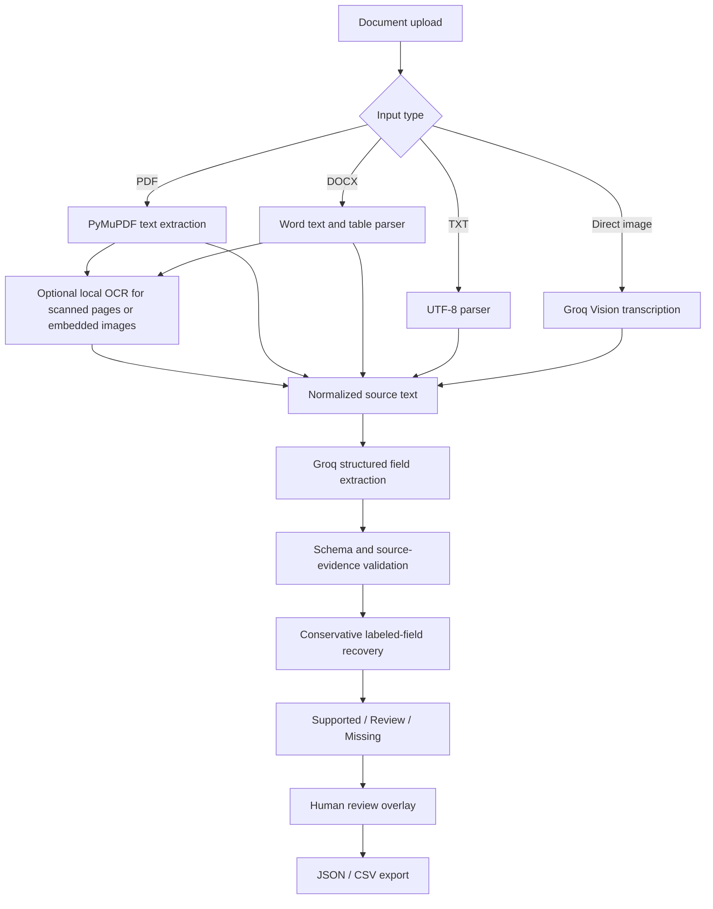

<div align="center">

# ChangeOrder Intelligence

### Evidence-grounded construction change-order extraction

**FastAPI · Groq · Next.js · Pydantic · PyMuPDF**

Transform construction change orders into structured, traceable data—while keeping uncertain claims visible and human verification separate from AI output.

**Document parsing** · **Field-level source evidence** · **Batch review** · **JSON / CSV exports**

[Quick Start](#quick-start) · [How It Works](#how-it-works) · [API Reference](#api-reference) · [Testing](#testing-and-verification) · [Security](#security-privacy-and-limitations)

</div>

---

## Overview

Construction change orders often contain critical scope, cost, timeline, and approval information in semi-structured documents. Manual transcription is time-consuming, while unconstrained AI extraction can return plausible but unsupported answers.

**ChangeOrder Intelligence** is a document-review application that:

1. Reads construction change orders from supported file formats.
2. Extracts **11 predefined business fields** into a typed JSON contract.
3. Associates each extracted value with a source quote and page number when available.
4. Checks evidence against extracted or transcribed source text and flags missing, ambiguous, or inconsistent values.
5. Allows reviewers to record corrections **without overwriting the original AI result**.
6. Exports structured results and reviewer annotations as JSON or CSV.

The product is designed as a **technical evaluation / demonstration workspace**, not as an autonomous approval engine or a production-secured multi-user SaaS platform.

## Core capabilities

| Area | Implemented behavior |
| --- | --- |
| **Structured extraction** | 11 change-order fields with value, status, confidence indicator, and evidence |
| **Evidence grounding** | Verbatim text-quote matching; PDF page references when available |
| **Financial checks** | Validates explicit total change-order amounts; distinguishes totals from line items; flags contradictions |
| **Missing-data handling** | Returns `null` and `missing` rather than inventing values; selectively recovers clearly labeled facts |
| **Batch processing** | Up to five documents per request; files processed sequentially and failures reported individually |
| **Human review** | Separate reviewer value, note, and timestamp; machine result stays intact |
| **Exports** | JSON with original evidence/reviews; Excel-friendly CSV with formula-injection mitigation |
| **Image support** | Direct image text transcription using Groq Vision, followed by the change-order extractor |
| **Frontend** | Responsive glassmorphism review workspace, document tabs, filters, image previews, and readable source transcripts |
| **Quality checks** | Backend pytest suite and Next.js production build; GitHub Actions workflow included |

> **Scope:** General-purpose OCR is not the business objective. A non-change-order image may be transcribed successfully yet have all 11 change-order fields marked `missing`. That is expected behavior.

## Supported inputs

| Format | Processing path | Notes |
| --- | --- | --- |
| `.pdf` | PyMuPDF text extraction → Groq text model | PDF evidence references 1-based page numbers. Scanned pages can use optional local Tesseract OCR. |
| `.docx` | `python-docx` text, tables, headers and footers → Groq text model | Document page numbers are not available; `evidence.page` can be `null`. |
| `.txt` | UTF-8 decoding → Groq text model | UTF-8 input only. |
| `.jpg`, `.jpeg`, `.png`, `.webp`, `.tif`, `.tiff` | Groq Vision transcription → Groq text model | **No local Tesseract needed** for directly uploaded images. Vision transcription is not independent pixel-level verification. |

**Limits:** 10 MB per file by default · 5 files per batch · 100 PDF pages · up to 12 PDF pages requiring OCR · 120,000 extracted characters · 14-megapixel image safety cap. Some document/image expansion limits are enforced separately. Password-protected PDFs and legacy `.doc` files are not supported.

## How it works



**Reliability approach:** The model proposes values and evidence; the application validates the proposed quote against available source text, applies deterministic checks to amounts/dates/approvals, and surfaces uncertainty. Explicitly labeled financial totals may be recovered from source text when unambiguous. It does **not** arbitrarily sum costs or turn a pending approval into an approved one.

**Important evidence distinction:** For direct images, source quotes are checked against the **Groq Vision transcript**, not against the original image pixels. For OCR-derived text, the same limitation applies to recognition quality. Visually verify consequential data in the original document.

## Technology stack

| Layer | Technology |
| --- | --- |
| Backend | Python 3.13, FastAPI, Uvicorn, Pydantic |
| Document parsing | PyMuPDF, python-docx, Pillow |
| AI text extraction | Groq Chat Completions (`GROQ_MODEL`) |
| Image transcription | Groq Vision (`GROQ_VISION_MODEL`) |
| Optional local OCR | Tesseract + pytesseract (scanned PDFs / embedded figures) |
| Frontend | Next.js 15, React 19, TypeScript, CSS, Lucide icons |
| Testing / automation | pytest, GitHub Actions; Next.js build/type validation |

## Repository structure

```text
changeorder-intelligence/
├── .github/workflows/quality.yml   # Backend tests + frontend build
├── backend/
│   ├── app/
│   │   ├── main.py                 # Routes, limits, batch isolation
│   │   ├── config.py               # Environment configuration
│   │   ├── extract.py              # PDF/DOCX/TXT/image parsing
│   │   ├── ai.py                   # Groq text model and extraction
│   │   ├── vision.py               # Groq Vision image transcription
│   │   ├── ocr.py                  # Optional Tesseract OCR
│   │   ├── grounding.py            # Source verification and recovery
│   │   └── schemas.py              # Typed response models
│   ├── tests/                       # Regression tests
│   ├── .env.example                 # Safe configuration template
│   ├── requirements.txt
│   └── Dockerfile                  # Optional backend container
├── frontend/
│   ├── app/page.tsx                 # Extraction and review workspace
│   ├── app/globals.css              # Mirror-glass design
│   ├── app/layout.tsx
│   ├── .env.example
│   └── package.json
├── DEPLOYMENT_AND_TESTING.md
├── .gitignore
└── README.md
```

## Quick start

The following commands use **Windows Command Prompt (CMD)**. Git is **not** required to run the application locally.

### Prerequisites

- Python **3.13** (the version used in local development)
- Node.js and npm (Node **22** is used by the included GitHub workflow)
- A Groq API key with access to the configured models
- Internet access for model requests
- *Optional:* Tesseract OCR for scanned PDFs and images **embedded inside** PDFs/DOCX. Direct photo uploads use Groq Vision and do not need Tesseract.

### 1. Configure and start the API

From the repository root:

```bat
cd backend
python -m venv .venv
.venv\Scripts\activate.bat
python -m pip install -r requirements.txt
copy .env.example .env
```

Edit **`backend/.env`** and set your own key:

```dotenv
GROQ_API_KEY=your_key_here
GROQ_MODEL=openai/gpt-oss-20b
GROQ_VISION_MODEL=qwen/qwen3.8-27b
MAX_UPLOAD_MB=10
ENABLE_RECOVERY_PASS=true
CORS_ORIGINS=http://localhost:3000
```

> Model names and model access can change; use model identifiers currently enabled in your Groq account. Never commit `.env` or put the API key in frontend source or `NEXT_PUBLIC_*` variables.

Start the backend **from the `backend` directory**, so its `.env` is loaded:

```bat
python -m uvicorn app.main:app --reload
```

- Health: **http://127.0.0.1:8000/health**
- Interactive API docs: **http://127.0.0.1:8000/docs**

`"ai_configured": true` on `/health` only indicates that a key is set; it does **not** validate model access or Groq availability.

### 2. Configure and start the web app

Open a **second CMD terminal** from the repository root:

```bat
cd frontend
npm install
copy .env.example .env.local
npm run dev
```

Open **http://localhost:3000**.

`frontend/.env.local` contains a *public API origin*, not a secret:

```dotenv
NEXT_PUBLIC_API_URL=http://127.0.0.1:8000
```

### 3. Analyze a document

1. Select one to five authorized construction change-order documents.
2. Click **Analyze** and inspect the processed-document tabs.
3. Check each value, status, source quote and available page reference.
4. For ambiguous fields, use **Verify / correct** and enter a reviewer note.
5. Export **JSON** or **CSV** before leaving or refreshing the page.

The app has **no persistent review database**; review notes exist in the browser session only.

## Extraction contract

Each document returns these fields:

| Field | Meaning |
| --- | --- |
| `change_order_number` | Change-order identifier |
| `project_name` | Project title |
| `contractor` | Contractor name |
| `client` | Client or owner |
| `description` | Requested work/change description |
| `reason` | Reason for the change |
| `cost_impact` | Change-order cost amount |
| `currency` | Explicit currency code, where identifiable |
| `schedule_impact_days` | Schedule impact in days |
| `request_date` | Date the change was requested |
| `approval_status` | Approval state, including pending/rejected when stated |

Each field follows the same structure:

```json
{
  "value": 3000,
  "confidence": 0.95,
  "evidence": {
    "quote": "Total change order cost: USD 3,000.",
    "page": 1
  },
  "status": "supported"
}
```

*Illustrative field from a synthetic test document, not a real contract.*

**Statuses**

- `supported` — value is consistent with a matching source quote (for images: the AI transcript).
- `review` — a value was proposed, but support is insufficient or ambiguous.
- `missing` — a field could not be determined; typically `value: null`, `confidence: 0`.

**Confidence is a heuristic indicator, not a statistically calibrated accuracy probability.** Reviewer edits are exported in a separate `human_reviews` overlay and never silently alter machine evidence.

## API reference

The FastAPI Swagger specification is available at `/docs`.

| Method | Path | Purpose |
| --- | --- | --- |
| `GET` | `/health` | Process health and whether an AI key is configured |
| `POST` | `/api/v1/extract` | Extract one multipart upload named `file` |
| `POST` | `/api/v1/extract/batch` | Extract 1–5 uploads named `files`; return successes and per-file failures |

**Single-document request:**

```bat
curl.exe -X POST "http://127.0.0.1:8000/api/v1/extract" -F "file=@Construction_Change_Order_Test.pdf"
```

**Batch request:**

```bat
curl.exe -X POST "http://127.0.0.1:8000/api/v1/extract/batch" -F "files=@Construction_Change_Order_Test.pdf" -F "files=@Construction_Change_Order_Test.docx"
```

The batch response contains `results`, `failures` and `requested`. A batch may return **HTTP 200 even if individual files failed**; always inspect `failures[].status_code` and `failures[].detail`.

Typical error cases include invalid files (`422`), unsupported formats (`415`), oversized uploads (`413`), missing/invalid provider configuration (`503`), rate limiting (`429`), and upstream/provider response failures (`502`/`503`). Groq rate limits are account-dependent and retries cannot override a depleted quota.

## Testing and verification

### Backend

From `backend/` with the environment activated:

```bat
python -m pytest -q
```

**Latest observed local result (Windows, 10 Oct 2026):** `57 passed, 2 skipped, 1 warning` in 12.37 seconds. The warning is from the Starlette/httpx test-client dependency combination; it did not fail the suite. Skipped tests were **not** executed and should not be counted as passes.

The regression suite covers parsing and validation, evidence checks, labeled financial recovery, batch failure isolation, and image/OCR handling. Mocked tests are **not proof of live model availability or measured extraction accuracy**.

### Frontend

From `frontend/`:

```bat
npm run build
```

**Latest observed local result (Windows, 10 Oct 2026):** Next.js `15.5.27` compiled successfully, including lint/type validation and static page generation. The repository's GitHub Actions workflow runs backend tests and the frontend build on pushes and pull requests; its status should be checked after the repository is published.

### Suggested acceptance checks

- Compare a text-based change-order PDF with the source document, including total cost, currency, dates, schedule impact and pending approvals.
- Repeat with a DOCX version and confirm that Word page numbers are not fabricated.
- Test a batch containing both valid and invalid files; successful results must remain available.
- Upload a direct photo and compare the Groq Vision transcript with the actual pixels before relying on numeric values.
- Check a document with missing or contradictory facts; review status must be visible.
- Confirm reviewer notes and original AI data remain separate in JSON and CSV exports.
- Verify a production frontend build and review all skipped tests before external delivery.

## Configuration reference

| Variable | Location | Purpose |
| --- | --- | --- |
| `GROQ_API_KEY` | `backend/.env` | **Required secret** for extraction and direct image transcription |
| `GROQ_MODEL` | `backend/.env` | Groq text extraction model; default `openai/gpt-oss-20b` |
| `GROQ_VISION_MODEL` | `backend/.env` | Direct image transcription model; default `qwen/qwen3.8-27b` |
| `MAX_UPLOAD_MB` | `backend/.env` | Per-file size limit; default `10` |
| `ENABLE_RECOVERY_PASS` | `backend/.env` | Optional focused recovery request; default `true` |
| `CORS_ORIGINS` | `backend/.env` | Comma-separated allowed frontend origins |
| `TESSERACT_CMD` | `backend/.env` | Optional path to local Tesseract executable |
| `OCR_LANGUAGE` | `backend/.env` | Local OCR language; default `eng` |
| `NEXT_PUBLIC_API_URL` | `frontend/.env.local` | Browser-visible backend URL; no secrets here |

## Security, privacy and limitations

**Currently implemented**

- Request upload-size and parser safety bounds, including image/document expansion constraints.
- Error isolation for individual files in batch processing.
- Source-aware verification and explicit missing/review states.
- `Cache-Control: no-store`, `X-Content-Type-Options: nosniff`, and `Referrer-Policy: no-referrer` on API responses.
- No application-level permanent file storage or persistent review history.
- CSV escaping to reduce formula-injection risks when opening exported data in spreadsheet software.

**Important limitations**

- **Not publicly hardened:** no account authentication, per-user quota enforcement, tenant isolation, malware scanner, or persistent audit log. Do not expose an unrestricted Groq-backed API to the public internet.
- **External processing:** extracted document text goes to Groq; **direct image bytes** go to Groq Vision. Upload only information you have permission to share and review the provider's data-handling terms.
- **OCR dependency:** direct photos work without Tesseract, but scanned PDFs and text inside PDF/DOCX figures use optional local OCR and require the Tesseract executable.
- **No guarantee of completeness:** model output, OCR text, handwritten text and financial interpretation can be inaccurate. Source evidence is not a substitute for human approval.
- **No durable reviews:** annotations and image previews live in the browser session; export before refreshing or closing.
- **Provider limits:** rate limits, model availability, network errors and quota exhaustion can interrupt extraction. Retries are bounded but are not a guaranteed recovery mechanism.

See **[DEPLOYMENT_AND_TESTING.md](DEPLOYMENT_AND_TESTING.md)** for the optional backend Docker image, manual acceptance checklist, and public-deployment security prerequisites.

## Troubleshooting

| Problem | Action |
| --- | --- |
| `/health` works but extraction fails | Check Groq key/model settings and backend logs; the health route does not call Groq. |
| `HTTP 429` from Groq | Check quota and rate limits, wait for reset, and avoid repeated manual retries. |
| `HTTP 503: OCR is not installed` | Only relevant to scanned PDFs/embedded images using local OCR; install/configure Tesseract. Direct uploaded photos use Groq Vision. |
| `0/11` fields on an unrelated image | Expected: this system extracts construction *change orders*, not arbitrary document schemas. |
| Batch endpoint returns `200` but some items failed | Inspect the response's `failures` array; successful files are returned separately. |
| Browser cannot reach API | Check backend process, `NEXT_PUBLIC_API_URL`, frontend origin and `CORS_ORIGINS`. |
| CMD cannot activate the environment | Use `.venv\Scripts\activate.bat` in CMD; PowerShell uses a different script. |
| Results vanish after refresh | Browser-session-only design; download JSON/CSV before leaving. |

## Project status and intended use

This repository demonstrates **source-first AI extraction, defensible uncertainty handling, and reviewable engineering decisions** for a construction-document workflow. It is suitable for local evaluation, technical discussion and further controlled testing. Additional controls and validation are needed before organizational deployment or decisions involving real construction contracts.

**Author:** [Muhammad Jawad](https://github.com/jawad-hua) · [Portfolio](https://muhammadjawad-ai.vercel.app/)

**Copyright © 2026 Muhammad Jawad. All rights reserved.** No open-source license is included in this repository.
